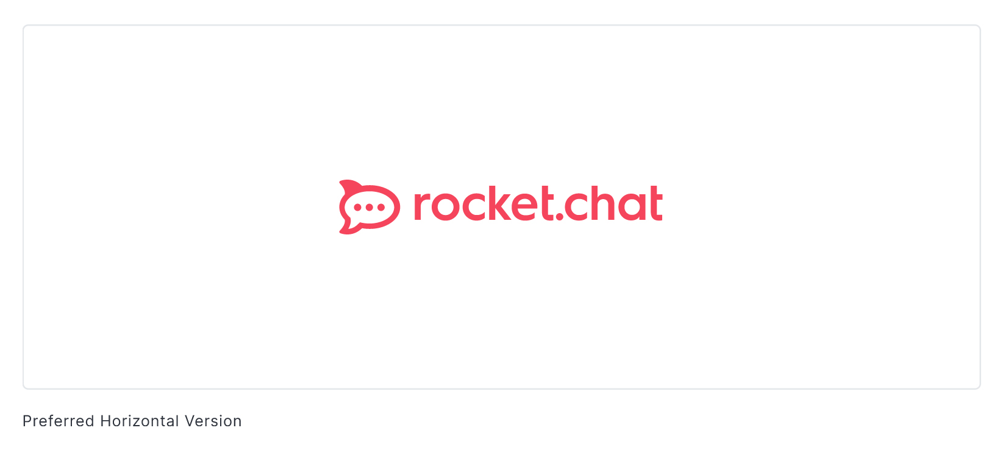

# Rocket.Chat Docker Official Image



Rocket.Chat is a web chat server developed in JavaScript using the Meteor full-stack framework. It enables communities and companies to privately host their own chat service.

This repository contains the Dockerfiles and supporting files used to build official Rocket.Chat Docker images.

## Repository structure

- `8.3/`, `8.4/`, `8.5/`, etc. — Dockerfiles for specific Rocket.Chat release lines.
- `templates/` — Templates used by the image automation.
- `images/` — Repository images and assets.
- `.github/workflows/` — GitHub Actions workflows for image automation and testing.
- `compose.yml` — Deprecated Docker Compose configuration.

## Build an image locally

You can build an image using one of the version-specific Dockerfiles.

For example, to build the Dockerfile in the `8.9` directory:

```bash
docker build -t rocketchat:local -f ./8.9/Dockerfile .
```

The final `.` is important: it sets the repository root as the Docker build context.

To build another release line, replace `8.9` with the corresponding directory.

This command builds the image locally. It does not start a Rocket.Chat server or configure MongoDB.

## Deployment

The `compose.yml` file in this repository is deprecated.

For the current Docker Compose deployment instructions, refer to:

- [Deploy with Docker Compose](https://docs.rocket.chat/docs/deploy-with-docker-docker-compose)
- [Rocket.Chat Compose repository](https://github.com/RocketChat/rocketchat-compose)

## Contributing

Contributions to improve the Dockerfiles, automation, documentation, and image build process are welcome.

Before submitting a pull request:

1. Keep changes focused on the relevant image version or repository files.
2. Verify Dockerfile changes locally when possible.
3. Provide a clear description of the problem and proposed solution in your pull request.
